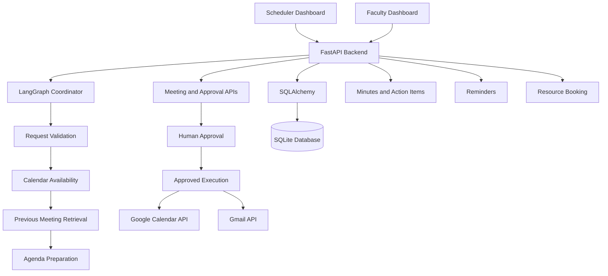

# AI Meeting Organizer Agent

An AI-assisted meeting management system that streamlines meeting planning, participant availability checks, agenda preparation, faculty approvals, calendar scheduling, email communication, meeting minutes, action-item tracking, reminders, and resource booking.

The project is built with Python, FastAPI, Streamlit, LangGraph, SQLAlchemy, SQLite, Google Calendar API, and Gmail API. It uses a human-in-the-loop approach: the system can prepare and validate meeting information, while designated users review and approve consequential actions.

---

## Table of Contents

- [1. Project Overview](#1-project-overview)
- [2. Problem Statement](#2-problem-statement)
- [3. Project Objectives](#3-project-objectives)
- [4. Key Features](#4-key-features)
- [5. System Architecture](#5-system-architecture)
- [6. Meeting Workflow](#6-meeting-workflow)
- [7. Technology Stack](#7-technology-stack)
- [8. Project Structure](#8-project-structure)
- [9. Prerequisites](#9-prerequisites)
- [10. Installation and Setup](#10-installation-and-setup)
- [11. Google API Configuration](#11-google-api-configuration)
- [12. Running the Application](#12-running-the-application)
- [13. Application URLs](#13-application-urls)
- [14. Backend API Modules](#14-backend-api-modules)
- [15. Database Design](#15-database-design)
- [16. Agentic AI Concepts](#16-agentic-ai-concepts)
- [17. Human Approval and Governance](#17-human-approval-and-governance)
- [18. Testing](#18-testing)
- [19. Demonstration Guide](#19-demonstration-guide)
- [20. Troubleshooting](#20-troubleshooting)
- [21. Security Notes](#21-security-notes)
- [22. Current Scope and Limitations](#22-current-scope-and-limitations)
- [23. Future Enhancements](#23-future-enhancements)
- [24. Author and Project Information](#24-author-and-project-information)

---

## 1. Project Overview

The AI Meeting Organizer Agent is a meeting coordination application designed to reduce the manual effort involved in organizing academic and professional meetings.

A Scheduler can submit a meeting request with its title, purpose, participants, preferred date, preferred time, and duration. The backend validates the request and coordinates a workflow that checks participant availability, retrieves relevant previous meeting information, and prepares an agenda.

A Faculty member or authorized meeting owner can review the request and make an approval decision. Once the required approval is recorded, the system can create a Google Calendar event and manage related email communication.

The application also supports meeting minutes, action items, reminders, and resource booking.

### Main principle

**AI-assisted preparation with human-controlled approval and execution.**

The system is intended to assist meeting organizers, not to replace the decisions of faculty members or meeting owners.

---

## 2. Problem Statement

Meeting coordination often requires several disconnected activities:

- Collecting meeting requirements from participants.
- Checking calendar availability.
- Finding a suitable meeting time.
- Preparing an agenda.
- Obtaining approval from the responsible person.
- Sending invitations and reminders.
- Recording meeting minutes.
- Assigning and tracking action items.
- Booking rooms or other resources.

When these activities are handled manually, information can become fragmented, approvals may be missed, and follow-up tasks can be difficult to track.

The AI Meeting Organizer Agent brings these activities into a coordinated workflow with a shared backend and persistent records.

---

## 3. Project Objectives

1. Provide a central interface for submitting and managing meeting requests.
2. Validate meeting information before processing.
3. Check participant availability using Google Calendar.
4. Retrieve relevant previous meeting information where available.
5. Prepare structured meeting agendas.
6. Enable faculty or meeting-owner review and approval.
7. Create calendar events after the required approval.
8. Manage Gmail drafts and approved email delivery.
9. Generate meeting-minutes drafts from supplied notes.
10. Track action items, owners, deadlines, and statuses.
11. Support reminders and resource booking.
12. Maintain records of important workflow and approval activities.

---

## 4. Key Features

### 4.1 Scheduler Dashboard

The Scheduler Dashboard provides the interface for creating and monitoring meetings.

Features include:

- Meeting request submission.
- Meeting title and purpose.
- Participant email addresses.
- Preferred date and time.
- Meeting duration.
- Meeting history.
- Minutes generation from meeting notes.
- Action-item tracking.
- Calendar availability and scheduling operations.
- Resource-booking operations.
- Access to supported integration endpoints through the dashboard's API interface, where configured.

### 4.2 Faculty Dashboard

The Faculty Dashboard supports review and governance.

Features include:

- Viewing pending meeting requests.
- Reviewing meeting details.
- Approving or rejecting requests.
- Reviewing generated meeting minutes.
- Managing action-item statuses.
- Recording review decisions.

### 4.3 Coordinator Workflow

The coordinator manages the meeting preparation workflow.

Its demonstrated stages include:

1. Request validation.
2. Participant availability checking.
3. Previous-meeting retrieval.
4. Agenda preparation.
5. Workflow result generation.

### 4.4 Google Calendar Integration

The Calendar integration supports:

- Checking participant availability through the FreeBusy API.
- Creating Google Calendar events after approval.
- Recording the created event ID and event link.
- Recording calendar status in the meeting record.

### 4.5 Gmail Integration

The Gmail integration supports:

- Creating email drafts.
- Managing meeting-related email records.
- Creating reminder email drafts.
- Sending approved email drafts.
- Recording email delivery status.

### 4.6 Meeting Minutes

The minutes workflow supports:

- Accepting meeting notes.
- Generating a structured minutes draft.
- Extracting action items from the supported input format.
- Submitting minutes for review.
- Recording review decisions.

Minutes should be based on supplied notes or transcripts. The system should not invent discussion content.

### 4.7 Action-Item Tracking

Action items can include:

- Task description.
- Assigned owner.
- Deadline.
- Status.
- Update timestamp.
- User recorded as the updater.

Supported statuses in the application include pending, in progress, completed, and cancelled.

### 4.8 Reminders

The reminder workflow supports creating reminder records, reviewing and approving them, and tracking their status.

### 4.9 Resource Booking

The resource-booking workflow supports:

- Creating resources.
- Listing available resources.
- Requesting a resource for an approved meeting.
- Checking resource capacity.
- Checking overlapping approved bookings.
- Approving or rejecting booking requests.

### 4.10 Audit Records

Important operations write audit records so that actions and decisions can be traced. The availability of a user-facing audit-history endpoint or dashboard view depends on the current API implementation.

---

## 5. System Architecture

The application is organized into four main layers.

### 5.1 Frontend Layer

**Technology:** Streamlit

The frontend contains two separate dashboards:

- Scheduler Dashboard
- Faculty Dashboard

The dashboards send HTTP requests to the FastAPI backend.

### 5.2 Backend Layer

**Technology:** FastAPI

The backend is responsible for:

- Receiving requests.
- Validating input.
- Calling the coordinator workflow.
- Managing approval operations.
- Connecting to database services.
- Calling Calendar and Gmail services.
- Returning structured responses.

### 5.3 Agent Orchestration Layer

**Technology:** LangGraph and Python

The coordinator organizes the meeting-preparation process into connected workflow stages. Python tools perform specific operations such as time calculations, participant parsing, availability checks, and agenda preparation.

### 5.4 Data and Integration Layer

**Technologies:** SQLAlchemy, SQLite, Google Calendar API, Gmail API

- SQLite stores application records.
- SQLAlchemy maps Python models to database tables.
- Google Calendar checks availability and creates events.
- Gmail creates and sends approved email drafts.

### Architecture Diagram



---

## 6. Meeting Workflow

The intended end-to-end workflow is:

1. The Scheduler enters meeting information in the Scheduler Dashboard.
2. The dashboard sends the request to the FastAPI meeting endpoint.
3. The backend validates the meeting request.
4. The coordinator checks participant availability using Google Calendar FreeBusy.
5. The workflow retrieves relevant previous meeting information where available.
6. The workflow prepares an agenda.
7. The meeting request and approval record are stored.
8. A Faculty member or authorized meeting owner reviews the request.
9. The reviewer approves or rejects the request.
10. After approval, the Calendar endpoint can create the Google Calendar event.
11. The system can prepare and send approved email communication.
12. Meeting notes can be submitted for minutes generation and review.
13. Action items can be tracked and reminders managed.
14. Resource booking can be requested and approved separately.

**Important:** Meeting approval, Calendar event creation, email approval, and email sending are distinct operations. A successful meeting request does not by itself mean that invitations have been sent or a Calendar event has been created.

---

## 7. Technology Stack

| Technology | Role in the project |
|---|---|
| Python 3.11 | Main programming language |
| FastAPI | Backend REST API |
| Streamlit | Scheduler and Faculty dashboards |
| LangGraph | Coordinator workflow orchestration |
| LangChain | Agent ecosystem and framework dependencies |
| SQLAlchemy | Database ORM |
| SQLite | Persistent relational database |
| Pydantic | Request schemas and configuration validation |
| Google Calendar API | Participant availability and event creation |
| Gmail API | Email draft creation and delivery |
| Google OAuth 2.0 | Authorization for Google APIs |
| Uvicorn | ASGI server for FastAPI |
| Pytest | Automated testing framework |
| HTTPX | HTTP client/testing dependency |
| MCP | MCP-style connector demonstration in the learning labs |

### Python dependencies

The project dependencies are listed in `requirements.txt`. The current project uses packages including:

```text
langchain
langgraph
langchain-openai
fastapi
uvicorn[standard]
streamlit
google-api-python-client
google-auth-httplib2
google-auth-oauthlib
python-dotenv
pydantic-settings
sqlalchemy
pytest
httpx
mcp[cli]
```

The exact installed package versions can be recorded in a lock file or generated requirements snapshot when preparing a reproducible release.

---

## 8. Project Structure

The main project structure is organized as follows:

```text
meeting-organizer-agent/
│
├── app/
│   ├── agents/
│   │   ├── capstone_workflow.py
│   │   └── meeting_tools.py
│   │
│   ├── api/
│   │   ├── main.py
│   │   ├── email_schemas.py
│   │   ├── calendar_schemas.py
│   │   ├── resource_schemas.py
│   │   └── routes/
│   │       ├── meetings.py
│   │       ├── approvals.py
│   │       ├── minutes.py
│   │       ├── action_items.py
│   │       ├── reminders.py
│   │       ├── emails.py
│   │       ├── calendar.py
│   │       └── resource_bookings.py
│   │
│   ├── config/
│   │   └── settings.py
│   │
│   ├── dashboards/
│   │   ├── scheduler_dashboard.py
│   │   └── faculty_dashboard.py
│   │
│   ├── database/
│   │   ├── connection.py
│   │   └── models.py
│   │
│   ├── services/
│   │   ├── calendar_service.py
│   │   └── gmail_service.py
│   │
│   └── tools/
│
├── data/
│   └── meeting_organizer.db
│
├── docs/
├── tests/
│
├── credentials.json
├── token.json
├── .env
├── .gitignore
├── requirements.txt
├── main.py
└── README.md
```

> This is the logical structure of the application. Some files may be added, renamed, or omitted in the local working copy. Keep the README aligned with the actual repository before publishing it.

---

## 9. Prerequisites

Install the following before running the application:

- Windows 11 or another supported operating system.
- Python 3.11.
- Visual Studio Code.
- Git (recommended).
- A Google account for Calendar and Gmail integration.
- A Google Cloud project with the required APIs enabled.

Verify Python:

```powershell
python --version
```

The project environment should use Python 3.11 rather than a different global Python installation.

---

## 10. Installation and Setup

### Step 1: Clone the repository

If the project is hosted on GitHub:

```powershell
git clone <YOUR_GITHUB_REPOSITORY_URL>
cd meeting-organizer-agent
```

Alternatively, open the existing project folder in VS Code.

### Step 2: Create a virtual environment

For a new installation:

```powershell
py -3.11 -m venv .venv
```

### Step 3: Activate the virtual environment

On Windows PowerShell:

```powershell
.\.venv\Scripts\Activate.ps1
```

If PowerShell blocks script activation, use the appropriate execution-policy setting for your environment or activate the environment through another supported terminal.

### Step 4: Upgrade pip

```powershell
python -m pip install --upgrade pip
```

### Step 5: Install dependencies

```powershell
python -m pip install -r requirements.txt
```

### Step 6: Configure environment variables

Create a `.env` file in the project root if required by `app/config/settings.py`.

Example template:

```env
APP_NAME=AI Meeting Organizer Agent
APP_VERSION=1.0.0
DATABASE_URL=sqlite:///./data/meeting_organizer.db
```

Add any additional settings required by the actual application configuration. Do not put real secrets in this example or commit them to version control.

### Step 7: Configure Google API credentials

Follow the instructions in [Google API Configuration](#11-google-api-configuration).

### Step 8: Initialize the database

Use the database initialization or migration scripts supplied in the repository. The project has used scripts for initializing and adding meeting, minutes, reminder, email, calendar, and resource-booking tables or columns.

Run only the scripts required for the current database state. Do not rerun schema-creation or migration scripts blindly against an existing database.

---

## 11. Google API Configuration

The project uses Google Calendar and Gmail APIs.

### 11.1 Create a Google Cloud project

1. Open the Google Cloud Console.
2. Create or select a project.
3. Enable the Gmail API.
4. Enable the Google Calendar API.
5. Configure the OAuth consent screen.
6. Add the Google account used for testing as a test user if the application is in testing mode.
7. Create an OAuth client ID for a Desktop application.
8. Download the OAuth client credentials JSON file.

### 11.2 Store credentials securely

Place the downloaded credentials file at the path expected by the application, currently configured as:

```text
credentials.json
```

The project also uses:

```text
token.json
```

for the OAuth token generated during authorization.

Both files must remain private and must not be committed to GitHub.

### 11.3 OAuth scopes

The integration has used these scopes:

```python
SCOPES = [
    "https://www.googleapis.com/auth/gmail.compose",
    "https://www.googleapis.com/auth/calendar.freebusy",
    "https://www.googleapis.com/auth/calendar.events",
]
```

If the required scopes change, the user may need to remove the old local OAuth token and authorize again. Do this only when necessary, because it initiates a new consent flow.

### 11.4 Participant email requirements

The Calendar FreeBusy API requires participant email addresses, not display names.

Correct format:

```text
faculty.one@example.com, faculty.two@example.com
```

Incorrect format:

```text
Dr. Ravi, Dr. Priya
```

Availability results can depend on the participants' calendar permissions and privacy settings.

---

## 12. Running the Application

Run the backend and the two dashboards in three separate terminals.

### Terminal 1: Start FastAPI

```powershell
cd D:\AAI\meeting-organizer-agent
.\.venv\Scripts\Activate.ps1
python -m uvicorn app.api.main:app --reload
```

### Terminal 2: Start Scheduler Dashboard

```powershell
cd D:\AAI\meeting-organizer-agent
.\.venv\Scripts\Activate.ps1
streamlit run app/dashboards/scheduler_dashboard.py
```

### Terminal 3: Start Faculty Dashboard

```powershell
cd D:\AAI\meeting-organizer-agent
.\.venv\Scripts\Activate.ps1
streamlit run app/dashboards/faculty_dashboard.py --server.port 8502
```

Keep all three terminals running while using the application.

---

## 13. Application URLs

| Application | URL |
|---|---|
| FastAPI root | http://127.0.0.1:8000/ |
| FastAPI health check | http://127.0.0.1:8000/health |
| Swagger API documentation | http://127.0.0.1:8000/docs |
| Scheduler Dashboard | http://localhost:8501 |
| Faculty Dashboard | http://localhost:8502 |

The Streamlit port may differ if the default port is already in use.

---

## 14. Backend API Modules

The backend is divided into route modules.

| API module | Responsibility |
|---|---|
| Meetings | Create, list, and retrieve meeting requests |
| Approvals | List pending approvals and record decisions |
| Minutes | Generate, retrieve, and review meeting minutes |
| Action Items | Create, retrieve, and update action items |
| Reminders | Generate, list, approve, and cancel reminders |
| Emails | Create email drafts, approve them, and send approved drafts |
| Calendar | Check participant availability and create Calendar events |
| Resource Bookings | Manage resources and booking requests |

### Important API operations

The following paths reflect the route structure implemented in the project:

| Method | Endpoint | Purpose |
|---|---|---|
| POST | `/meetings/` | Submit a meeting request |
| GET | `/meetings/` | List meetings |
| GET | `/meetings/{meeting_id}` | Retrieve a meeting |
| GET | `/approvals/pending` | List pending approvals |
| POST | `/approvals/{approval_id}/decide` | Approve or reject a request |
| POST | `/minutes/{meeting_id}/generate` | Generate minutes |
| GET | `/minutes/{meeting_id}` | Retrieve minutes |
| POST | `/minutes/{meeting_id}/review` | Review minutes |
| GET | `/action-items/` | List action items |
| GET | `/action-items/meeting/{meeting_id}` | List action items for a meeting |
| POST | `/calendar/meetings/{meeting_id}/availability` | Check calendar availability |
| POST | `/calendar/meetings/{meeting_id}/create` | Create a Calendar event |
| GET | `/resources/` | List resources |
| POST | `/resources/` | Create a resource |
| POST | `/resources/bookings` | Request a resource booking |
| GET | `/resources/bookings` | List resource bookings |
| POST | `/resources/bookings/{booking_id}/decide` | Approve or reject a booking |

Additional routes are available for reminders and email delivery. Use the running Swagger documentation at `/docs` as the authoritative reference for the exact request schemas and all registered paths.

---

## 15. Database Design

The project uses SQLite with SQLAlchemy ORM.

### Main database models

| Model | Description |
|---|---|
| User | Stores user details and role information |
| Meeting | Stores meeting details, agenda, notes, minutes, and calendar information |
| Approval | Stores meeting approval requests and decisions |
| AuditLog | Stores records of important actions |
| ActionItem | Stores tasks, owners, deadlines, and statuses |
| Reminder | Stores reminder details and approval/delivery status |
| EmailDelivery | Stores email draft and delivery information |
| Resource | Stores room or other resource information |
| ResourceBooking | Stores resource booking requests and decisions |

### Meeting record

A meeting record can contain:

- Meeting title.
- Purpose.
- Preferred date and time.
- Duration.
- Participants.
- Agenda.
- Meeting notes.
- Minutes and minutes status.
- Calendar event ID and link.
- Calendar status.
- Meeting status.
- Creator and creation timestamp.

### Database location

The configured database file is:

```text
data/meeting_organizer.db
```

The exact database URL is controlled by the project settings.

---

## 16. Agentic AI Concepts

The project was developed through a sequence of learning labs that introduced and demonstrated agentic AI concepts.

| Lab | Concept | Project implementation or demonstration |
|---|---|---|
| 1 | Agent vs. Chatbot | Planner loop and revise cycle |
| 2 | Tool-Using Agent | Typed tools for calendar and meeting operations |
| 3 | Skill Creation | Reusable planning and formatting skills |
| 4 | Memory and Retrieval | SQLite keyword-based retrieval |
| 5 | MCP-Style Connector | Connector demonstration |
| 6 | Agent Runtime | Budgets, approval gates, checkpoints, and audit demonstration |
| 7 | Agentic Node Graph | Explicit workflow graph with state and conditional transitions |
| 8 | Parallel Swarm | Parallel specialist execution and result merging |
| 9 | Grounding | Evidence checks using keyword overlap |
| 10 | Operational Resilience | Retry handling and failure management |
| 11 | SDLC Factory | Specification-to-tested-output workflow |
| 12 | Safety and Governance | Role checks, approval, audit, and rollback demonstration |
| 13 | Discipline-Specific Agents | Faculty, examination, and research agenda routing |
| 14 | Capstone Integration | Integration of the meeting organizer worklet and dashboards |

### Important implementation distinction

Not every specialist component is an autonomous LLM-powered agent. Several workflows use deterministic Python logic, rules, and API tools. The coordinator uses LangGraph for workflow orchestration. The implementation should be described according to the behavior actually present in the code.

---

## 17. Human Approval and Governance

Human review is an important part of the system.

The intended governance rules are:

- Meeting requests require review by an authorized person.
- Calendar event creation is performed only after the meeting approval checks pass.
- Email drafts must be approved before sending.
- Resource bookings require approval.
- Minutes are treated as drafts until reviewed.
- Action items should not be marked complete without confirmation from the responsible person.
- Important decisions and operations should be recorded in the audit log.

### Prototype security limitation

The current API implementation has prototype-level identity handling in some routes. Certain operations accept an email address in a request body or query parameter rather than deriving the actor from a fully authenticated session.

Therefore, role checks in the current prototype must not be treated as production-grade authentication or authorization. A production deployment requires authenticated identities and server-enforced permissions.

---

## 18. Testing

### 18.1 Verify backend startup

```powershell
python -m uvicorn app.api.main:app --reload
```

Open:

```text
http://127.0.0.1:8000/health
```

Expected response:

```json
{
  "status": "healthy"
}
```

### 18.2 Verify API documentation

Open:

```text
http://127.0.0.1:8000/docs
```

Confirm that the expected routers and endpoints are registered.

### 18.3 Verify Python syntax

For an individual file:

```powershell
python -m py_compile app/agents/meeting_tools.py
```

### 18.4 Run automated tests

If tests are present:

```powershell
python -m pytest
```

### 18.5 Suggested end-to-end test

1. Submit a meeting request using valid participant email addresses.
2. Confirm that request validation succeeds.
3. Confirm that the Calendar availability check returns a meaningful result.
4. Confirm that the meeting and approval records are stored.
5. Review the request through the Faculty Dashboard.
6. Approve the request using the authorized review flow.
7. Check participant availability again if required by the Calendar route.
8. Create the Calendar event.
9. Verify the event in Google Calendar.
10. Create and approve an email draft.
11. Send the approved draft and verify delivery.
12. Submit meeting notes and generate a minutes draft.
13. Review the minutes.
14. Verify action items and resource-booking operations.
15. Inspect the available audit records.

Use test accounts and test data. Calendar event creation and Gmail sending can perform real external actions.

---

## 19. Demonstration Guide

A suggested project demonstration sequence:

### Step 1: Show the backend

Open:

http://127.0.0.1:8000/docs

Explain that FastAPI exposes the application's backend services.

### Step 2: Show the Scheduler Dashboard

Open:

http://localhost:8501

Demonstrate:

- Meeting title and purpose.
- Participant email addresses.
- Preferred date and time.
- Duration.
- Meeting request submission.

### Step 3: Show coordinator processing

Explain the workflow:

- Request validation.
- Calendar availability check.
- Previous-meeting retrieval.
- Agenda preparation.

### Step 4: Show meeting history

Demonstrate how submitted meetings are stored and displayed.

### Step 5: Show the Faculty Dashboard

Open:

http://localhost:8502

Demonstrate:

- Pending meeting requests.
- Meeting review.
- Approve or reject decision.
- Minutes review.
- Action-item management.

### Step 6: Show Google Calendar

Show the approved meeting event, if event creation has been completed successfully.

### Step 7: Show Gmail

Show the approved meeting-related email draft or sent message, depending on the completed test.

### Step 8: Show minutes and action items

Demonstrate the minutes draft, review status, and action-item tracking.

### Suggested presentation statement

> The AI Meeting Organizer Agent is a human-supervised meeting management system. A Scheduler submits meeting requirements, the coordinator validates the request and prepares meeting information, and an authorized Faculty member reviews it. After approval, the application can use Google Calendar and Gmail to support scheduling and communication. It also supports meeting minutes, action items, reminders, and resource booking.

---

## 20. Troubleshooting

### Problem: `ModuleNotFoundError`

**Possible cause:** The wrong Python interpreter or virtual environment is being used.

Activate the project environment:

```powershell
.\.venv\Scripts\Activate.ps1
```

Verify:

```powershell
python --version
python -c "import sys; print(sys.executable)"
```

Install dependencies if necessary:

```powershell
python -m pip install -r requirements.txt
```

### Problem: `IndentationError`

**Possible cause:** Python statements are placed at an incorrect indentation level.

Check the reported file and line number. Keep statements inside the appropriate function, `try` block, or context manager.

### Problem: Invalid time format

The meeting time parser expects a 12-hour time such as:

```text
12:00 PM
```

Avoid malformed inputs such as:

```text
1 : 00 PM
```

The meeting tool normalizes spaces around the colon before parsing.

### Problem: Google Calendar returns `notFound`

**Possible cause:** A participant name was entered instead of an email address, or the supplied calendar identity cannot be resolved.

Use valid participant email addresses:

```text
faculty.one@example.com
```

### Problem: Google API authorization error

Check:

- The correct Google APIs are enabled.
- OAuth consent is configured.
- The account is listed as a test user when required.
- The requested OAuth scopes are correct.
- The OAuth token has been authorized for the current scopes.

### Problem: Datetime serialization error

Google API JSON requests require serialized date-time values. Convert Python datetime objects to ISO 8601 strings where the API request body expects strings:

```python
start_time.isoformat()
end_time.isoformat()
```

### Problem: Dashboard cannot connect to backend

Confirm that FastAPI is running and that the dashboard's API base URL matches the backend address:

```text
http://127.0.0.1:8000
```

---

## 21. Security Notes

- Never commit `credentials.json`, `token.json`, or `.env`.
- Keep API credentials and OAuth tokens private.
- Use test accounts during development.
- Do not expose secrets in screenshots, logs, or demonstrations.
- Restrict access to the database file.
- Use authenticated user identities before production deployment.
- Enforce role-based authorization on the backend, not only in the dashboard.
- Review email recipients and event details before approving external actions.
- Back up the SQLite database before schema changes or migrations.

The `.gitignore` file should include at least:

```gitignore
.venv/
__pycache__/
*.py[cod]
.env
credentials.json
token.json
data/*.db
.pytest_cache/
```

Adjust database-file exclusions if the project intentionally tracks a sanitized sample database.

---

## 22. Current Scope and Limitations

This project is a capstone prototype and learning implementation. The following distinctions should be understood when evaluating it:

1. The coordinator workflow uses LangGraph, but several specialist operations are deterministic Python functions rather than autonomous LLM agents.
2. The memory demonstration uses SQLite keyword retrieval, not a production semantic vector database.
3. The grounding demonstration uses keyword-overlap checks and is not a comprehensive semantic fact-verification system.
4. Some runtime checkpoints and audit demonstrations are in-memory; persistent application audit records are handled separately through the database model.
5. Authentication and authorization are prototype-level in some API routes. Supplied email addresses are not equivalent to verified user identity.
6. Calendar and Gmail integrations depend on valid Google OAuth credentials, scopes, account permissions, and API availability.
7. The availability check depends on valid participant email addresses and accessible calendar information.
8. Resource conflict checks are application-level checks and do not provide transactional concurrency guarantees for simultaneous booking requests.
9. A user-facing audit-history screen or endpoint should only be claimed if it has been implemented and verified.
10. Deployment and production hardening require additional configuration and security work.

---

## 23. Future Enhancements

Possible future improvements include:

- Secure authentication and session management.
- Verified role-based access control.
- Persistent workflow checkpoints.
- More advanced semantic memory and retrieval.
- Stronger evidence-grounding and validation.
- Automated integration and end-to-end test coverage.
- Transaction-safe resource booking.
- A dedicated audit-history interface.
- Production deployment with HTTPS and managed secrets.
- Monitoring, structured logging, and operational alerts.
- Improved dashboard usability and accessibility.

These are future enhancements, not claims about the current implementation.

---

## 24. Author and Project Information

**Project:** AI Meeting Organizer Agent  
**Category:** Agentic AI / Workflow Automation  
**Primary Language:** Python  
**Backend:** FastAPI  
**Frontend:** Streamlit  
**Orchestration:** LangGraph  
**Database:** SQLite with SQLAlchemy  
**External Integrations:** Google Calendar API and Gmail API

### Project Summary

The AI Meeting Organizer Agent demonstrates how agentic workflow orchestration, API integrations, persistent data storage, and human approval can be combined to support the complete meeting-management lifecycle.

It brings meeting preparation, review, scheduling, communication, and follow-up into one coordinated application.

---

## License

Add the license selected for this repository before public distribution. Do not assume that the project is open source or assign a license without making that decision.
